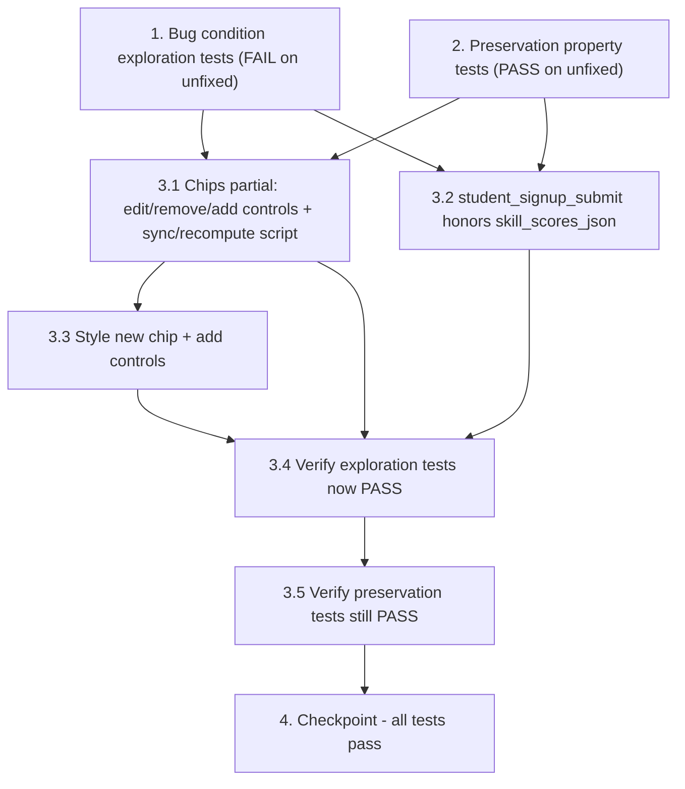

# Implementation Plan

## Overview

This plan fixes the non-functional "edit any value" / "edit freely" affordance on the skill chips rendered by `app/templates/partials/skill_chips.html`, adds a taxonomy-constrained control to manually add a skill the AI missed (including from the empty "No skills detected yet" state), and fixes the student submit handler that discards posted edits. It follows the exploratory bugfix workflow: first write bug-demonstrating tests and baseline-pinning preservation tests against the unfixed code, then apply the three-file fix (chips partial, `student_signup_submit`, stylesheet), then re-run both test sets to confirm the fix and the absence of regressions.

## Task Dependency Graph



```json
{
  "waves": [
    { "wave": 1, "tasks": ["1", "2"] },
    { "wave": 2, "tasks": ["3.1", "3.2"] },
    { "wave": 3, "tasks": ["3.3"] },
    { "wave": 4, "tasks": ["3.4"] },
    { "wave": 5, "tasks": ["3.5"] },
    { "wave": 6, "tasks": ["4"] }
  ]
}
```

## Tasks

- [x] 1. Write bug condition exploration tests (BEFORE implementing the fix)
  - **Property 1: Bug Condition** - Editable, addable, synced, recomputed, and persisted skill chips
  - **CRITICAL**: These tests MUST FAIL on unfixed code - failure confirms the bug exists
  - **DO NOT attempt to fix the test or the code when it fails**
  - **NOTE**: These tests encode the expected behavior - they will validate the fix when they pass after implementation
  - **GOAL**: Surface counterexamples that demonstrate the bug (`isBugCondition` from design: extracted skills are shown AND the user wants to edit a value OR remove a skill, OR the user wants to add a skill the AI missed — including from the empty state — AND no edit/remove/add control exists / hidden JSON is not synced / student path discards posted edits)
  - **Scoped PBT Approach**: The chip-control and add-control assertions are deterministic, so scope them to concrete extracted sets (e.g. `python`/`git` from the fallback taxonomy) and to the empty extraction; the server-persistence assertions are parameterized over several posted edited/added sets
  - Add a new pytest module `tests/test_skill_chips_edit_remove.py` reusing the in-memory SQLite + `get_session` override + `settings.llm_mode = "off"` fixture pattern from `tests/test_student_skills_preview.py` and `tests/test_flow_api.py`
  - Test case 1 (student discard) — `POST /student/signup` with a readable resume (e.g. `"I know some python and git"`) plus `skill_scores_json` equal to a DIFFERENT edited set (e.g. `{"python": 0.5}` with `git` removed); assert the persisted `StudentRequest.skill_scores` equals the posted edited set. On unfixed code this FAILS because the handler re-extracts and ignores the posted JSON (counterexample: persisted set is the re-extracted set, not `{"python": 0.5}`)
  - Test case 2 (student added-skill discard) — `POST /student/signup` with a resume that does NOT mention a given skill (e.g. a Python-only resume) plus `skill_scores_json` containing an ADDED canonical skill the resume lacks (e.g. `{"sql": 0.6}`); assert the persisted `StudentRequest.skill_scores` contains `sql`. On unfixed code this FAILS because the handler re-extracts from the resume and the added `sql` is dropped (counterexample: `sql` absent from the persisted set)
  - Test case 3 (no edit/remove controls) — render the chips via `POST /mentor/skills/extract` (or `POST /student/skills/extract` with a file) producing a non-empty `skill_scores`; assert the fragment contains a per-chip editable confidence control and a remove control carrying `data-skill` (e.g. `class="chip-remove"` and an `input` with `data-skill`). On unfixed code this FAILS (chips are read-only `<span>` only)
  - Test case 4 (no add control, populated branch) — using the same non-empty render, assert the fragment contains a taxonomy-constrained add control (`class="chip-add-select"` with taxonomy-derived `<option>`s whose `value` is a canonical id, plus a `class="chip-add"` button). On unfixed code this FAILS (no add control exists)
  - Test case 5 (no add control in empty state) — render the partial via an extraction that yields NO skills; assert the empty branch shows "No skills detected yet" AND a taxonomy-constrained add control (`chip-add-select` / `chip-add`). On unfixed code this FAILS because the empty branch offers no way to add a skill (Requirement 2.10 defect)
  - Test case 6 (editing note) — assert the populated fragment's note is consistent with the controls (no longer "edit any value below" with no controls; e.g. mentions removing and adding a skill). On unfixed code this FAILS
  - Run these tests on UNFIXED code
  - **EXPECTED OUTCOME**: Tests FAIL (this is correct - it proves the bug exists)
  - Document the counterexamples found (student path persists re-extracted skills regardless of posted `skill_scores_json`, dropping both edits and added skills; chips fragment exposes no edit/remove/add control in either branch)
  - Mark task complete when the tests are written, run, and the failures are documented
  - _Requirements: 1.1, 1.2, 1.3, 1.4, 1.5, 1.7, 1.8, 2.1, 2.2, 2.3, 2.6, 2.8, 2.10_

- [x] 2. Write preservation property tests (BEFORE implementing the fix)
  - **Property 2: Preservation** - Unedited, un-added, and unrelated behavior
  - **IMPORTANT**: Follow observation-first methodology — run the UNFIXED code for inputs where `isBugCondition` is false, record the actual outputs, then assert those outputs
  - Add these tests to `tests/test_skill_chips_edit_remove.py` (or extend the preservation block already present in `tests/test_student_skills_preview.py`), reusing the same fixture
  - Observe and assert (Requirement 3.2, unedited student): `POST /student/signup` posting `skill_scores_json` EQUAL to what the resume extracts (`extract_skills(resume_text, db)`) persists `StudentRequest.skill_scores` identical to the extracted set — this must still hold after the fix because posting the extracted set verbatim is a no-op edit
  - Observe and assert (Requirement 3.2, unedited mentor): `POST /mentor/signup` posting `skill_scores_json` equal to the extracted set persists `MentorProfile.skill_scores` verbatim (baseline already passes; must stay true)
  - Observe and assert (Requirement 3.3, no skills and no add): `POST /student/skills/extract` / `POST /mentor/skills/extract` with text yielding no skills renders "No skills detected yet" and hidden `value="{}"`; a student submission with an empty resume path and no added skills persists `{}`
  - Observe and assert (Requirement 3.5, canonical ids only): `POST /student/signup` posting a `skill_scores_json` whose keys are canonical taxonomy ids (as the picker always emits) persists exactly those canonical id keys, unchanged by the `{k: float(v)}` coercion (only values are coerced; keys are preserved verbatim); no unknown/free-text key is persisted
  - Observe and assert (Requirement 3.7, absent/malformed JSON): `POST /student/signup` with `skill_scores_json` missing and with `skill_scores_json="not json"` falls back to re-extraction without crashing (303 redirect)
  - Property-based (Requirement 3.4): generate random skill sets `{skill_id: confidence in [0,1]}`, compute `experience_score`/`experience_level` directly, and assert the helpers return the documented values (guards against accidental helper changes) — property-based testing gives stronger universal guarantees across the input domain
  - Observe and assert (Requirement 3.6): other fields (goal, specialty, availability, top3, outcomes, specialties) persist exactly as before on a representative student submission
  - Run these tests on UNFIXED code
  - **EXPECTED OUTCOME**: Tests PASS (this confirms the baseline behavior to preserve)
  - Mark task complete when the tests are written, run, and passing on unfixed code
  - _Requirements: 3.1, 3.2, 3.3, 3.4, 3.5, 3.6, 3.7_

- [x] 3. Fix for non-editable / non-removable / non-addable skill chips and discarded student-path edits

  - [x] 3.1 Add per-chip edit + remove controls, a taxonomy-constrained add control (both branches), and a self-initializing sync/recompute script to the chips partial
    - In `app/templates/partials/skill_chips.html`, inside the populated (``) branch, render per chip: the skill label (`taxonomy[sid].label if sid in taxonomy else sid`), an editable confidence control (`type="number"` with `min="0" max="100" step="1"`, representing percent, and/or a `range` slider) carrying `data-skill="{{ sid }}"`, and a remove button (`type="button" class="chip-remove" data-skill="{{ sid }}" aria-label="Remove ..."`)
    - Render a taxonomy-constrained add control in BOTH the populated (``) branch AND the empty (``) branch: a `<select class="chip-add-select" aria-label="Add a skill">` with a disabled placeholder option plus one `<option value="{{ sid }}">{{ entry.label }}</option>` per `taxonomy.items()` (option `value` = canonical id, option text = label), followed by a `<button type="button" class="chip-add">Add</button>`. The taxonomy is already in context on every render path, so no new server context variable is required
    - Keep the hidden `<input type="hidden" name="{{ field_name }}" value='{{ skill_scores|tojson }}'>` as the initial/sync target in both branches
    - Preserve the empty (``) branch's "No skills detected yet" message and `value="{}"` — now accompanied by the add control (do not remove the message or change the empty hidden value)
    - Update the editing note to match the controls (e.g. "AI estimate — adjust any value, remove a skill, or add one below.")
    - Add an inline `<script>` at the end of the partial that self-initializes for the just-rendered chips (so it reruns after every `hx-swap="outerHTML"` into `#skill-chips-result`): build an in-memory `{skill_id: confidence}` map from the current hidden-input JSON, then wire up the controls
    - On confidence change: clamp percent to `[0,100]`, convert to a `0–1` float, update the map, rewrite the hidden input's `value` as JSON, recompute the badge/score
    - On remove: delete the entry from the map, remove the chip element, rewrite the hidden input, recompute
    - On add: read the selected canonical id from the picker; if the id is already in the map, update/keep its existing chip (MERGE — do not append a second chip or duplicate key — Requirement 2.4); otherwise insert a new chip for that id (label from the picker option text) at a default initial confidence (~0.5), user-editable like any other chip and clamped to `[0,1]`; then merge into the map, rewrite the hidden input, recompute. The add handler MUST handle the empty → non-empty transition: when adding from the "No skills detected yet" state, convert the empty placeholder into a chips container so the first added chip, the updated hidden field, and the recomputed badge all appear (Requirement 2.10)
    - Implement the client recompute as a mirror of the skills-service rules: `score = mean(top 5 confidences descending)`, `0` when empty, rounded to 2 decimals; `level = beginner (<0.35) | intermediate (<0.65) | advanced (≥0.65)`; update the `.badge badge-<level>` class/label and the `(score …)` text, accounting for added skills (display only)
    - _Bug_Condition: isBugCondition(input) = (hasExtractedSkills AND (userWantsToEditValue OR userWantsToRemoveSkill)) OR userWantsToAddSkill, AND (NOT editControlExists OR NOT addControlExists OR NOT hiddenJsonReflects(editedSet) OR submittedEditsIgnored)_
    - _Expected_Behavior: editControlsExist(result) AND addControlExists(result) in both branches AND added skill maps to a canonical taxonomy id AND hiddenJson(result) = userEditedSkillSet (with additions merged, no duplicate keys) AND displayedLevel(result) = experience_level(experience_score(userEditedSkillSet)) with every confidence (including an added skill's initial confidence) clamped to [0,1]_
    - _Preservation: empty "No skills detected yet" branch and `value="{}"` unchanged when the user adds nothing; `experience_score`/`experience_level` helpers not modified; only canonical taxonomy ids written to the hidden field_
    - _Requirements: 2.1, 2.2, 2.3, 2.4, 2.5, 2.6, 2.7, 2.9, 2.10_

  - [x] 3.2 Make the student submit handler honor a posted `skill_scores_json`
    - In `app/routers/pages.py`, add `skill_scores_json: str = Form("{}")` to `student_signup_submit` (`POST /student/signup`)
    - Replace the unconditional `scores = extract_skills(resume_text, db)` with the same honor-if-present-else-extract logic the mentor handler already uses: `try: posted = json.loads(skill_scores_json) if skill_scores_json else {}` / `except json.JSONDecodeError: posted = {}`; `if posted: scores = {k: float(v) for k, v in posted.items()}` `elif resume_text.strip(): scores = extract_skills(resume_text, db)` `else: scores = {}`
    - Added skills require NO extra server change: the add control emits the same `{skill_id: confidence}` shape under canonical taxonomy ids, so an added entry is just another key in `posted`. The `{k: float(v) for k, v in posted.items()}` coercion preserves the id keys verbatim (only values are coerced to float), and because the picker only produces canonical ids, no unknown/free-text key can be persisted (Requirement 3.5). Merge-not-duplicate is enforced client-side (a JSON object cannot hold duplicate keys anyway)
    - Keep computing `exp_s = experience_score(scores)` and `experience_level(exp_s)` from `scores` so the server stays authoritative for experience values and matching; leave `goal_skills`/`goal_type` and all other fields unchanged
    - Do NOT modify `app/services/skills.py`
    - _Bug_Condition: submittedEditsIgnored(path="student", userEditedSet) — student handler discards posted JSON, dropping edits AND added skills_
    - _Expected_Behavior: persistedSkills(result) = userEditedSkillSet (including added canonical ids) on both student and mentor paths_
    - _Preservation: absent/empty/malformed JSON falls back to re-extraction without crashing (3.7); unedited posting of the extracted set persists it verbatim (3.2); only canonical id keys persisted (3.5)_
    - _Requirements: 2.5, 2.8, 3.2, 3.5, 3.7_

  - [x] 3.3 Style the new chip + add controls
    - In `app/static/styles.css`, add minimal rules for the per-chip numeric/slider input, the `.chip-remove` button, and the add control (`.chip-add-select` / `.chip-add`) so they sit within the existing `.chips` layout and `.chip` pill
    - Reuse the existing `.chips` / `.chip` / `.badge-*` classes; do not change existing chip/badge rules
    - _Requirements: 2.1, 2.2, 2.3_

  - [x] 3.4 Verify the bug condition exploration tests now pass
    - **Property 1: Expected Behavior** - Editable, addable, synced, recomputed, and persisted skill chips
    - **IMPORTANT**: Re-run the SAME tests from task 1 - do NOT write new tests
    - The tests from task 1 encode the expected behavior; when they pass, the fix is confirmed
    - Run the bug condition exploration tests from task 1 (student discard, student added-skill discard, no edit/remove controls, no add control in populated branch, no add control in empty state, editing note)
    - **EXPECTED OUTCOME**: Tests PASS (confirms the bug is fixed — edit/remove/add controls exist in both branches, the hidden JSON is synced including additions, and the student path persists the posted edited-and-added set)
    - _Requirements: 2.1, 2.2, 2.3, 2.4, 2.5, 2.6, 2.7, 2.8, 2.9, 2.10_

  - [x] 3.5 Verify the preservation tests still pass
    - **Property 2: Preservation** - Unedited, un-added, and unrelated behavior
    - **IMPORTANT**: Re-run the SAME tests from task 2 - do NOT write new tests
    - Run the preservation property tests from task 2
    - **EXPECTED OUTCOME**: Tests PASS (confirms no regressions: extraction, unedited submission, no-skills-no-add `{}`, canonical-ids-only persistence, `experience_score`/`experience_level`, other fields, and absent/malformed JSON fallback are unchanged)
    - Confirm all tests still pass after the fix
    - _Requirements: 3.1, 3.2, 3.3, 3.4, 3.5, 3.6, 3.7_

- [x] 4. Checkpoint - Ensure all tests pass
  - Run the full suite (`pytest`) and confirm the new tests plus the existing `tests/` modules all pass
  - Optionally add an integration test: extract via `/student/skills/extract`, submit `/student/signup` with an edited `skill_scores_json` that also includes an ADDED skill, then load `/student/matches` and confirm the edited-and-added set drives `experience_level` and matching
  - Optionally add an add-from-empty integration test: with an extraction that yields no skills, submit a single added canonical skill and confirm the persisted set is exactly that added skill (Requirement 2.10)
  - DOM/manual verification (no JS test harness): after an extract swap replaces `#skill-chips-result`, editing a value, removing a chip, and adding a skill from the picker each update the hidden `skill_scores_json` and the displayed badge/score; re-adding an existing skill updates its chip rather than duplicating it; adding from the empty "No skills detected yet" state produces the first chip
  - Ensure all tests pass, ask the user if questions arise

## Notes

- Tasks 1 and 2 are written and run BEFORE the fix. Task 1 tests MUST fail on unfixed code (they confirm the bug); task 2 tests MUST pass on unfixed code (they pin the baseline to preserve).
- The `**Property N:**` annotations (Property 1 = Bug Condition / Expected Behavior, Property 2 = Preservation) are required for hover status and must not be renamed.
- The skills service helpers in `app/services/skills.py` are NOT modified; the client-side recompute only mirrors their documented rules for display, and the server recompute (via `experience_score`/`experience_level`) remains authoritative.
- The add control is taxonomy-constrained (a `<select>`/`<datalist>` populated from `taxonomy`, option value = canonical id), so added skills are always canonical ids (Requirements 2.3, 3.5); the `{k: float(v)}` coercion in both handlers preserves those id keys verbatim, so no server change beyond the student handler adopting the mentor pattern is needed.
- The project has no JS test harness, so client-side edit/add/sync/recompute behavior (including merge-not-duplicate and the empty → non-empty add transition) is covered by server-side persistence tests plus DOM/manual verification; the authoritative automatable guarantee is that a posted `skill_scores_json` (including added canonical ids) is persisted on both submit paths.
- Tests use pytest with FastAPI `TestClient`, an in-memory SQLite engine, a `get_session` dependency override, and `settings.llm_mode = "off"` for deterministic fallback extraction, following `tests/test_student_skills_preview.py` and `tests/test_flow_api.py`.
