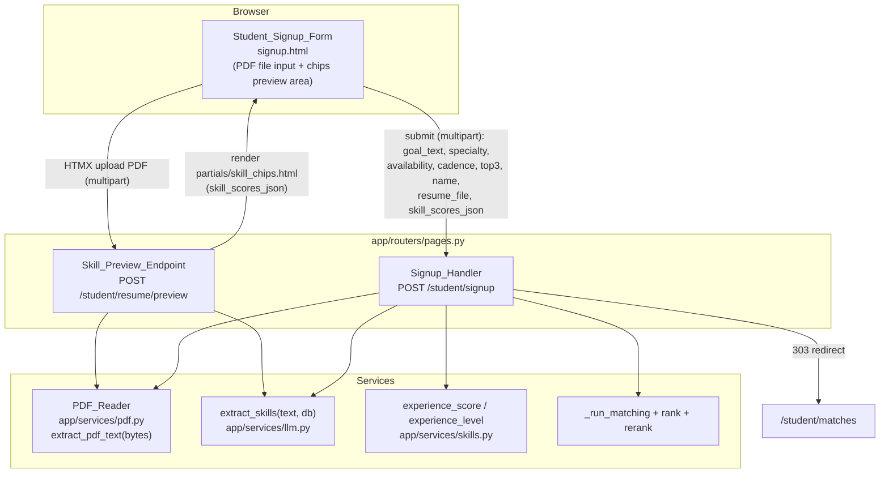

# Design Document

## Overview

This feature reworks the Sprout student sign-up flow so that:

1. The manual "skills to learn" chip picker (and its hidden `skills_to_learn` field and
   supporting script) is removed from `app/templates/student/signup.html`.
2. The meeting Cadence_Selector (`<select name="cadence">`) renders **after** the availability
   ("When are you free?") section.
3. `Skills_To_Learn` is inferred from the student's **goal text only** by running it through the
   existing `extract_skills(text, db)` pipeline.
4. The resume is supplied as a **PDF upload** that is read server-side with `pypdf`, and its
   extracted text feeds the same `extract_skills` pipeline to estimate current `Skill_Scores`.
5. A new HTMX **Skill_Preview_Endpoint** lets the student upload the PDF and review/edit the
   estimated skills (via `partials/skill_chips.html`) before final submission; the reviewed
   `skill_scores_json` is preferred over re-extraction on submit.

### Current-code reconciliation (important)

The requirements describe the historical form (chip picker + resume paste box + "Find my skills"
button posting to `/student/skills/extract`). The code on disk has already partially evolved past
that description. This design targets the **requirements' end state** and must reconcile the
following real differences found in the code:

- `app/templates/student/signup.html` **already uses a file input** (`name="resume_file"`), but it
  currently accepts **PDF/DOCX/TXT** and is marked **`required`**. Requirement 4 and Requirement 5
  scope the upload to **PDF only** and **optional**. The design narrows accept to PDF and makes the
  upload optional.
- The template **has no Cadence_Selector at all today** and **no skills-to-learn chip picker**
  (those were already removed in a prior edit). Requirement 1 is therefore already satisfied for the
  picker; Requirement 2 requires us to (re)introduce the Cadence_Selector and place it after
  availability. The design adds the Cadence_Selector in the correct position.
- `student_signup_submit` currently calls a local `_resume_text_from_upload()` helper that supports
  PDF/DOCX/TXT and **raises `HTTPException(422)`** on empty/unsupported/unreadable files, and it
  already infers `skills_to_learn` from `goal_text`. This design **replaces the raise-on-error
  behavior with graceful degradation** (empty scores) per Requirement 5, and routes PDF reading
  through a dedicated `PDF_Reader` component.
- Two existing tests assert the old behavior and must be updated (see Testing Strategy):
  `test_student_signup_requires_resume_file` and `test_student_signup_rejects_unsupported_resume_file`
  in `tests/test_flow_api.py`.
- The old HTMX route `POST /student/skills/extract` (`student_skills_extract`, text-based) is
  replaced by the new multipart `Skill_Preview_Endpoint`.

### Research notes

- **`pypdf` is already declared** in both `requirements.txt` (`pypdf>=4.0`) and `pyproject.toml`
  (`pypdf>=4.0`). Requirement 8.1 is satisfied with no manifest change; no PyMuPDF is introduced.
- `pypdf.PdfReader(stream)` raises on encrypted PDFs (`PdfReadError` / "File has not been
  decrypted") and on malformed input; `page.extract_text()` can return `None` for pages with no
  extractable text. The reader must catch these and return empty text rather than propagating, so
  the handler can treat the file as unreadable (Requirement 5.3, 8.2).
- `extract_skills(text, db)` (in `app/services/llm.py`) is the single shared pipeline: it tries the
  cached/live LLM, validates with `SkillScores` (taxonomy-only keys, clamped 0–1), and falls back to
  `fallback_extract` keyword scanning on any failure. With `LLM_MODE=off` (the test config) it
  always uses the deterministic fallback. Passing empty/whitespace text yields `{}` via
  `fallback_extract`.
- `SkillScores` (in `app/schemas/ai.py`) silently drops non-taxonomy keys and clamps/round values,
  so the inferred skill ids are always canonical taxonomy ids — satisfying Requirement 3.3.
- `experience_score(scores)` / `experience_level(score)` (in `app/services/skills.py`) are pure and
  return `0.0` / `"beginner"` for an empty dict, so empty scores degrade cleanly (Requirement 4.8).
- `StudentRequest` already has every column this feature writes: `skills_to_learn`, `skill_scores`,
  `resume_text`, `experience_score`, `experience_level`, `cadence`, `availability`, `top3`,
  `goal_text`, `goal_type`, `specialty`.

## Architecture



### Request/response flows

**Preview (optional, pre-submit):** The student selects a PDF and triggers an HTMX POST to
`/student/resume/preview`. The endpoint reads the bytes with the `PDF_Reader`, runs the text through
`extract_skills`, and swaps the rendered `skill_chips.html` fragment into `#skill-chips-result`. The
fragment carries the estimated scores in a hidden `skill_scores_json` field the student can edit.

**Submit:** On form submit the whole form (including the file and any `skill_scores_json` produced by
the preview) posts as `multipart/form-data` to `/student/signup`. The handler:
- infers `Skills_To_Learn` from `goal_text` only,
- chooses `Skill_Scores` = posted `skill_scores_json` if present, else extracts from the PDF text,
- stores `resume_text` + `skill_scores`, computes experience, runs matching, and redirects.

## Components and Interfaces

### 1. PDF_Reader — new module `app/services/pdf.py`

A small, pure, DB-free helper that converts uploaded bytes to text and never raises on bad input.

```python
# app/services/pdf.py
from __future__ import annotations

import logging
from io import BytesIO

logger = logging.getLogger(__name__)

# 10 MB, per Requirement 5.4
MAX_PDF_BYTES = 10 * 1024 * 1024

OVERSIZE_MESSAGE = "That file is larger than the 10 MB limit. Upload a smaller PDF."
UNREADABLE_MESSAGE = "We couldn't read that PDF. You can still continue without it."


class PdfTooLarge(Exception):
    """Raised when the uploaded PDF exceeds MAX_PDF_BYTES."""


def extract_pdf_text(content: bytes) -> str:
    """Return extracted text from PDF bytes, or '' when unreadable/empty.

    Never raises for encrypted, corrupt, non-PDF, or empty input: those all
    return ''. Raises PdfTooLarge ONLY for the size-limit case so callers can
    surface the distinct size message (Requirement 5.4). Degrades to '' if
    pypdf cannot be imported (Requirement 8.2).
    """
    if content is None or len(content) == 0:
        return ""
    if len(content) > MAX_PDF_BYTES:
        raise PdfTooLarge()

    try:
        from pypdf import PdfReader
    except Exception:  # pypdf missing/broken at runtime -> treat as unreadable
        logger.warning("pypdf unavailable; treating upload as unreadable")
        return ""

    try:
        reader = PdfReader(BytesIO(content))
        # Encrypted PDFs raise here or on page access; caught below.
        pages_text = [(page.extract_text() or "") for page in reader.pages]
    except Exception as exc:  # encrypted / corrupt / not a PDF
        logger.info("PDF unreadable: %s", exc)
        return ""

    return "\n".join(pages_text).strip()
```

Design decisions:
- **Size-limit is the only signalled failure.** Everything else (encrypted/corrupt/non-PDF/empty/no
  text/pypdf-missing) collapses to `""`. This matches Requirement 5: unreadable and no-text both end
  with empty scores and sign-up succeeds, while only oversized gets the distinct size message
  (5.4). Returning `""` lets the handler and preview endpoint treat "unreadable" and "no text"
  identically with one code path.
- **No dependency on FastAPI.** The reader takes `bytes`, so it is trivially unit-testable with
  crafted inputs and reusable by both the preview endpoint and the submit handler.

### 2. Skill_Preview_Endpoint — new route in `app/routers/pages.py`

Replaces `POST /student/skills/extract` (text-based `student_skills_extract`).

- **Route:** `POST /student/resume/preview` — chosen to describe the new multipart,
  resume-file-driven behavior rather than the old text-field behavior.
- **Signature:** accepts the file as an optional `UploadFile`.

```python
@router.post("/student/resume/preview")
def student_resume_preview(
    request: Request,
    db: Session = Depends(get_session),
    resume_file: UploadFile | None = File(None),
):
    scores: dict[str, float] = {}
    message = ""
    if resume_file is not None:
        content = resume_file.file.read()
        try:
            text = extract_pdf_text(content)
        except PdfTooLarge:
            text = ""
            message = OVERSIZE_MESSAGE
        if text.strip():
            scores = extract_skills(text, db)
    exp_s = experience_score(scores)
    return render(
        "partials/skill_chips.html",
        {
            "request": request,
            "skill_scores": scores,
            "experience_level": experience_level(exp_s),
            "experience_score": round(exp_s, 2),
            "taxonomy": load_taxonomy(),
            "field_name": "skill_scores_json",
            "message": message,
        },
    )
```

Behavior mapping:
- Readable PDF with text → chips rendered with estimated scores + hidden `skill_scores_json`
  (Requirement 6.2, 6.3).
- Unreadable / no text → chips partial with empty scores (Requirement 6.4 / 5.3 / 5.5).
- Oversized → chips partial with empty scores **and** the size message surfaced (Requirement 5.4).
- The partial always returns `field_name="skill_scores_json"`, preserving the hidden-field contract
  the form round-trips (Requirement 6.5).

### 3. Signup_Handler — modified `student_signup_submit` in `app/routers/pages.py`

Target signature and logic (replacing the current `_resume_text_from_upload` raise-based flow):

```python
@router.post("/student/signup")
def student_signup_submit(
    request: Request,
    db: Session = Depends(get_session),
    name: str = Form("Demo Student"),
    goal_text: str = Form(...),
    specialty: str = Form(...),
    cadence: str = Form("weekly"),
    availability: str = Form(""),
    top3: str = Form(""),
    skill_scores_json: str = Form(""),
    resume_file: UploadFile | None = File(None),
):
    if not goal_text.strip():
        raise HTTPException(status_code=422, detail="Goal is required.")
    if specialty not in CS_ENGINEERING_SPECIALTIES:
        raise HTTPException(status_code=422, detail="Choose a valid CS or engineering specialty.")

    # 1. Read PDF text (optional, graceful). Oversize is surfaced but non-fatal.
    resume_text = ""
    if resume_file is not None:
        content = resume_file.file.read()
        try:
            resume_text = extract_pdf_text(content)
        except PdfTooLarge:
            resume_text = ""  # too large -> treated as no usable resume

    # 2. Determine current Skill_Scores: posted (reviewed) preferred over re-extraction.
    posted = _parse_skill_scores(skill_scores_json)
    if posted:
        scores = posted
    elif resume_text.strip():
        scores = extract_skills(resume_text, db)
    else:
        scores = {}

    # 3. Infer Skills_To_Learn from the GOAL TEXT ONLY.
    goal_skills = extract_skills(goal_text, db)   # {skill_id: conf}; keys are taxonomy ids

    # 4. Persist User + StudentRequest
    user = User(role="student", name=name, headshot_url="/static/avatars/avatar_9.svg")
    db.add(user)
    db.flush()

    exp_s = experience_score(scores)
    req = StudentRequest(
        student_id=user.id,
        goal_text=goal_text,
        goal_type=_infer_goal_type(goal_text),
        specialty=specialty,
        skills_to_learn=list(goal_skills),       # taxonomy ids only
        cadence=cadence,
        availability=_parse_multi(availability),
        top3=_parse_multi(top3),
        resume_text=resume_text,
        skill_scores=scores,
        experience_score=exp_s,
        experience_level=experience_level(exp_s),
    )
    db.add(req)
    db.flush()

    _run_matching(db, req)                        # unchanged
    db.commit()
    request.session["user_id"] = user.id
    request.session["request_id"] = req.id
    return RedirectResponse(url="/student/matches", status_code=303)
```

Supporting helper (new) for robust parsing of the posted hidden field, mirroring the mentor
handler's existing approach:

```python
def _parse_skill_scores(raw: str) -> dict[str, float]:
    if not raw or not raw.strip():
        return {}
    try:
        data = json.loads(raw)
    except json.JSONDecodeError:
        return {}
    if not isinstance(data, dict):
        return {}
    out: dict[str, float] = {}
    for k, v in data.items():
        try:
            out[k] = float(v)
        except (TypeError, ValueError):
            continue
    return out
```

Key changes vs. today:
- `resume_file` becomes **optional** (`UploadFile | None = File(None)`); the `required` upload and
  the "Resume text is required" 422 are removed (Requirement 5.1, 5.2).
- PDF reading goes through `extract_pdf_text` (PDF-only) instead of the multi-format
  `_resume_text_from_upload`; unreadable files no longer raise (Requirement 5.3, 8.2).
- `skills_to_learn` is derived from `goal_text` only and never includes resume text
  (Requirement 3.1–3.3); `list(goal_skills)` yields taxonomy ids.
- Posted `skill_scores_json` is preferred over re-extraction (Requirement 4.6 / 6.6).
- `_run_matching` and the `303` redirect to `/student/matches` are preserved
  (Requirement 7.1–7.3).
- `_resume_text_from_upload` (PDF/DOCX/TXT, raise-based) is removed. `python-docx` is no longer used
  by this flow; the manifest entry may stay but is out of scope to remove here.

### 4. Student_Signup_Form — `app/templates/student/signup.html`

- Keep `enctype="multipart/form-data"` on `<form method="post" action="/student/signup">`
  (Requirement 4.3; already present).
- Resume card: keep a single **PDF-only** file input, make it **not required**, and add an HTMX
  trigger that uploads to the preview endpoint and swaps the chips partial:

```html
<div class="card">
  <h3>2. Resume or project (optional)</h3>
  <p class="muted sample-note">
    Upload a PDF so we can estimate your current skills. You can skip this and still see matches.
  </p>
  <div class="field">
    <label for="student-resume">Upload a PDF</label>
    <input type="file" name="resume_file" id="student-resume" accept="application/pdf"
           hx-post="/student/resume/preview"
           hx-trigger="change"
           hx-encoding="multipart/form-data"
           hx-target="#skill-chips-result"
           hx-swap="outerHTML">
  </div>
  <div id="skill-chips-result">
    
  </div>
</div>
```

  Notes: the initial include renders the empty-state partial (empty `skill_scores`) so the hidden
  `skill_scores_json="{}"` exists even before any upload. `hx-encoding="multipart/form-data"` on the
  input makes HTMX send the chosen file. The partial's root element is `#skill-chips-result`, so
  `hx-target="#skill-chips-result"` + `hx-swap="outerHTML"` round-trips cleanly.

- **Cadence placement (Requirement 2):** render the Cadence_Selector in a card **after** the
  availability card. The handler already accepts `cadence` (default `weekly`), and valid options are
  `weekly` / `every_other_week` (from `VALID_CADENCES` in `app/schemas/student.py`):

```html
<div class="card">
  <h3>3. When are you free?</h3>
  
  
</div>

<div class="card">
  <h3>4. How often do you want to meet?</h3>
  <div class="field">
    <label for="cadence">Meeting cadence</label>
    <select name="cadence" id="cadence">
      <option value="weekly" selected>Weekly</option>
      <option value="every_other_week">Every other week</option>
    </select>
  </div>
</div>
```

- The "Three things that matter most" card and its pick-3 script are unchanged. There is **no**
  skills-to-learn chip picker, hidden `skills_to_learn` input, or related script in the template
  (Requirement 1.1–1.4) — confirmed absent in the current file; the design keeps them absent.

### 5. Skill_Chips_Preview partial — `app/templates/partials/skill_chips.html`

Update the empty-state copy to reflect PDF upload instead of paste, add optional message display,
and keep the editable hidden `skill_scores_json` contract intact:

```html
{# Context: skill_scores (dict), experience_level, experience_score, taxonomy, field_name,
   message (optional) #}
<div id="skill-chips-result">
  <p class="muted sample-note">{{ message }}</p>
  
    <p class="muted sample-note">AI estimate — edit any value below.</p>
    <div class="chips">
      
        <span class="chip">
          {{ taxonomy[sid].label if sid in taxonomy else sid }}
          <span class="conf">{{ (conf * 100)|round|int }}%</span>
        </span>
      
    </div>
    <p>Experience level:
      <span class="badge badge-{{ experience_level }}">{{ experience_level|capitalize }}</span>
      <span class="muted">(score {{ experience_score }})</span>
    </p>
    <input type="hidden" name="{{ field_name }}" value='{{ skill_scores|tojson }}'>
  
    <p class="muted">No skills detected yet. Upload your resume PDF to estimate your skills.</p>
    <input type="hidden" name="{{ field_name }}" value="{}">
  
</div>
```

The hidden `skill_scores_json` field is always present (populated or `{}`) so the preview result
round-trips into the submit (Requirement 6.5, 6.6). `message` is optional, so the mentor
skill-extract usage of this same partial (`/mentor/skills/extract`) remains compatible.

## Data Models

No schema/migration changes. Existing `StudentRequest` columns are reused exactly:

| Field | Type | Written by Signup_Handler |
| --- | --- | --- |
| `goal_text` | str | from `goal_text` form field |
| `goal_type` | str | `_infer_goal_type(goal_text)` (unchanged) |
| `specialty` | str | validated against `CS_ENGINEERING_SPECIALTIES` |
| `skills_to_learn` | list[str] | `list(extract_skills(goal_text))` — taxonomy ids only |
| `cadence` | str | from `cadence` form field (`weekly` default) |
| `availability` | list[str] | `_parse_multi(availability)` |
| `top3` | list[str] | `_parse_multi(top3)` |
| `resume_text` | str | `extract_pdf_text(pdf_bytes)` or `""` |
| `skill_scores` | dict[str,float] | posted `skill_scores_json` else from resume text else `{}` |
| `experience_score` | float | `experience_score(skill_scores)` |
| `experience_level` | str | `experience_level(experience_score)` |

`SkillScores` (`app/schemas/ai.py`) guarantees taxonomy-only, clamped values for pipeline output.
The posted `skill_scores_json` is parsed by `_parse_skill_scores` into `{str: float}`; it is already
derived from a prior pipeline render (taxonomy ids), so values flow straight into `skill_scores`.

## Correctness Properties

*A property is a characteristic or behavior that should hold true across all valid executions of a
system — essentially, a formal statement about what the system should do. Properties serve as the
bridge between human-readable specifications and machine-verifiable correctness guarantees.*

### Property 1: Skills-to-learn derive from goal text only

*For any* goal text and any resume PDF content, the `skills_to_learn` persisted on the
`StudentRequest` equals `list(extract_skills(goal_text, db))` and is independent of the resume
content — changing only the resume (holding goal fixed) never changes `skills_to_learn`.

**Validates: Requirements 3.1, 3.2, 3.3**

### Property 2: Empty-goal-skills yields empty list without error

*For any* goal text for which the extraction pipeline returns no skills, sign-up completes
successfully and the persisted `skills_to_learn` is the empty list.

**Validates: Requirements 3.4, 3.5**

### Property 3: Posted skill scores take precedence over re-extraction

*For any* submission carrying a non-empty, well-formed `skill_scores_json`, the persisted
`skill_scores` equals the parsed posted value and does not depend on the resume PDF text (the
pipeline is not re-run against the resume to determine current skills).

**Validates: Requirements 4.6, 6.6**

### Property 4: Resume PDF text drives skill scores when no posted scores

*For any* readable resume PDF whose extracted text is non-empty, when no `skill_scores_json` is
posted, the persisted `skill_scores` equals `extract_skills(extract_pdf_text(bytes), db)` and the
persisted `resume_text` equals the extracted text.

**Validates: Requirements 4.4, 4.5, 4.7**

### Property 5: Experience is a pure function of skill scores

*For any* resulting `skill_scores` map, the persisted `experience_score` equals
`experience_score(skill_scores)` and `experience_level` equals
`experience_level(experience_score(skill_scores))`.

**Validates: Requirements 4.8**

### Property 6: Unreadable, empty, or absent PDFs degrade to empty scores

*For any* uploaded content that is encrypted, corrupt, non-PDF, empty, yields no text, or is absent
entirely (and with no posted scores), `extract_pdf_text` returns `""`, the persisted `skill_scores`
is the empty map, the persisted `resume_text` is `""`, and sign-up still completes with a redirect
to `/student/matches`.

**Validates: Requirements 5.1, 5.2, 5.3, 5.5, 8.2**

### Property 7: Oversized PDFs are rejected with the size signal

*For any* uploaded content exceeding 10 MB, `extract_pdf_text` raises `PdfTooLarge`, the preview
endpoint returns the chips partial with empty scores and the 10 MB size message, and no resume text
is stored.

**Validates: Requirements 5.4**

### Property 8: Preview endpoint always returns the chips contract

*For any* input to the Skill_Preview_Endpoint (readable, unreadable, oversized, or absent), the
response renders `partials/skill_chips.html` containing exactly one hidden input named
`skill_scores_json` whose value is valid JSON representing the current scores (`{}` when empty).

**Validates: Requirements 6.1, 6.2, 6.3, 6.4, 6.5**

### Property 9: Skill ids are always canonical taxonomy ids

*For any* text fed through the extraction pipeline, every key in the resulting `skills_to_learn` and
`skill_scores` is a valid id in the loaded taxonomy (non-taxonomy keys never persist).

**Validates: Requirements 3.3**

## Error Handling

| Condition | Handling | Requirement |
| --- | --- | --- |
| Empty goal text | `HTTPException(422)` — goal is the one hard requirement | — (preserves existing guard) |
| Invalid specialty | `HTTPException(422)` | — (preserves existing guard) |
| No PDF uploaded | `resume_text=""`, `skill_scores={}`, sign-up completes | 5.1, 5.2 |
| Encrypted / corrupt / non-PDF / no-text PDF | `extract_pdf_text` returns `""` → empty scores; preview shows shared unreadable copy; sign-up completes | 5.3, 5.5 |
| PDF > 10 MB | `extract_pdf_text` raises `PdfTooLarge`; preview surfaces size message; handler treats as no usable resume and completes | 5.4 |
| `pypdf` import fails at runtime | `extract_pdf_text` returns `""` (logged); treated as unreadable | 8.2 |
| Malformed `skill_scores_json` | `_parse_skill_scores` returns `{}`; falls back to resume extraction (or empty) | 4.6 (robustness) |

Design rationale: only two conditions raise (empty goal, invalid specialty) because those are
genuine blockers for producing a meaningful request/match. Every PDF-related problem degrades
gracefully so an optional step never blocks the student (Requirement 5 user story). The size case is
the sole PDF condition surfaced with a distinct, actionable message.

## Testing Strategy

The project uses FastAPI `TestClient` with an in-memory SQLite DB and `LLM_MODE=off` (deterministic
fallback extraction), per `tests/test_flow_api.py`. Tests run via `uv run pytest`.

### Property-based testing applicability

`PDF_Reader.extract_pdf_text` is a pure `bytes -> str` function and is a good PBT candidate for the
size-limit boundary and the "never raises except oversize" invariant. The rest of the feature is
largely HTTP handlers, template rendering, and side effects (DB writes, redirects), which are better
covered by example-based integration tests with `TestClient`. We therefore use a **small set of
property tests for the pure reader** plus **integration tests for the flow**. Where a property above
describes handler/endpoint behavior, it is validated by the mapped integration example(s) rather
than a generative property test, since the behavior is dominated by I/O and does not meaningfully
vary across 100 random inputs.

### Property-based tests (pure `extract_pdf_text`)

Use `hypothesis` (add to dev deps) for the reader. Minimum 100 iterations per property; tag each
test with the design property it validates.

- `# Feature: student-signup-skill-inference-pdf, Property 7: oversized PDFs are rejected`
  — *for any* `bytes` of length > `MAX_PDF_BYTES`, `extract_pdf_text` raises `PdfTooLarge`.
- `# Feature: student-signup-skill-inference-pdf, Property 6: unreadable inputs degrade to ""`
  — *for any* `bytes` of length ≤ `MAX_PDF_BYTES` that are not a valid PDF (random/garbage bytes),
  `extract_pdf_text` returns `""` and never raises.
- Boundary examples around `MAX_PDF_BYTES` (exactly at limit passes the size gate; one byte over
  raises).

### Unit tests (`tests/test_pdf.py`, new)

- Empty bytes → `""`.
- A small, valid single-page PDF with known text → text contains that content (build the PDF
  in-test with `pypdf`'s writer, or a tiny checked-in fixture).
- Encrypted PDF fixture → `""` (no raise).
- Simulated `pypdf` import failure (monkeypatch `builtins.__import__` or patch the import site) →
  `""` (Property 6 / Requirement 8.2).

### Integration tests (`tests/test_flow_api.py` and a new `tests/test_student_signup_pdf.py`)

Mapped to properties/requirements:

1. **Signup without a PDF** → 303 to `/student/matches`; persisted `resume_text == ""` and
   `skill_scores == {}`; `skills_to_learn` reflects the goal. (Properties 2/6; Req 5.1, 5.2, 7.3)
2. **Signup with a readable PDF** (built in-test) whose text mentions known skills → `resume_text`
   non-empty; `skill_scores` matches `extract_skills(text)`; `experience_level` consistent.
   (Properties 4/5; Req 4.4–4.8)
3. **Skills inferred from goal only** → submit identical goal with two different resume PDFs; assert
   `skills_to_learn` is identical across both, and equals `extract_skills(goal_text)`.
   (Property 1; Req 3.1–3.3)
4. **Posted `skill_scores_json` preferred** → submit with a non-empty `skill_scores_json` plus a PDF;
   assert persisted `skill_scores` equals the posted value and not the re-extracted resume scores.
   (Property 3; Req 4.6, 6.6)
5. **Preview endpoint returns chips** → `POST /student/resume/preview` with a readable PDF returns
   HTML containing a `name="skill_scores_json"` hidden input with non-empty JSON; with garbage bytes
   returns the partial with `value="{}"`. (Property 8; Req 6.1–6.4)
6. **Oversized PDF** → `POST /student/resume/preview` with > 10 MB bytes returns the chips partial
   containing the size-limit message and `skill_scores_json` = `{}`. (Property 7; Req 5.4)
7. **Unreadable PDF on submit** → submit encrypted/garbage bytes with no posted scores → 303 to
   matches; `skill_scores == {}`, `resume_text == ""`. (Property 6; Req 5.3)
8. **Cadence after availability (rendered order)** → `GET /student/signup`; assert the response HTML
   has the `name="cadence"` select appearing **after** the availability grid marker
   (`class="avail-grid"` / "When are you free?"), and that both `weekly` and `every_other_week`
   options exist. (Req 2.1, 2.2)
9. **Manual picker removed** → `GET /student/signup`; assert the HTML contains no `id="skills-to-learn"`
   and no `name="skills_to_learn"`. (Req 1.1, 1.2)
10. **Downstream matching preserved** → extend the existing end-to-end flow so the student signup
    step uploads a PDF (or omits it) and the remaining mentorship flow still completes. (Req 7.1–7.3)

### Existing tests to update

- `test_student_signup_requires_resume_file`: today asserts `422` when no file is sent. Under the new
  optional-upload behavior this must change to assert a **303 redirect** (sign-up succeeds without a
  file). (Req 5.1)
- `test_student_signup_rejects_unsupported_resume_file`: today asserts `422` for a non-PDF upload.
  Under graceful handling, an unreadable/non-PDF upload no longer 422s; update to assert a **303**
  with empty `skill_scores`. (Req 5.3)
- `test_one_flow_end_to_end`: the signup step currently sends a `.txt` resume via `files=`. Update to
  either omit the file or send a valid in-test PDF, since only PDFs are read now.

### Dependency check

- Confirm `pypdf` remains in `requirements.txt` and `pyproject.toml` (it does); no PyMuPDF added.
- Add `hypothesis` to dev dependencies for the reader's property tests.
